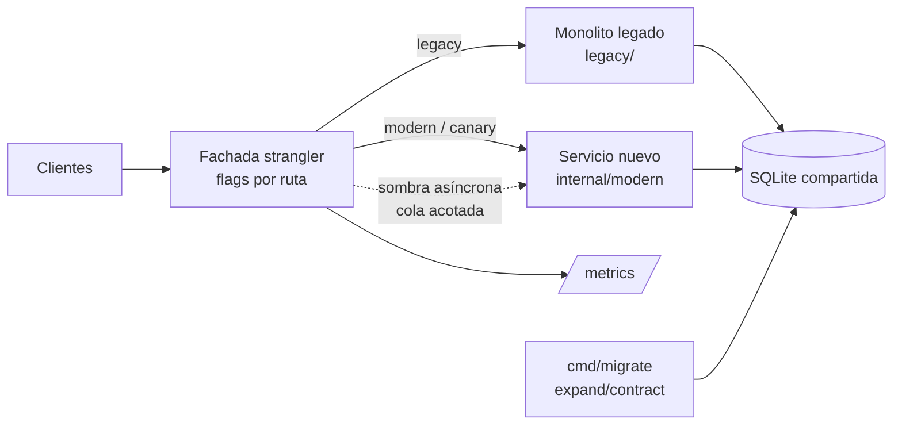

# cortex9-legacy-crm-strangler-migration

Caso de estudio completo de **modernización de un CRM legado sin apagarlo**: un monolito con deuda real (consultas N+1, estado global, errores tragados, ningún test) se reemplaza ruta por ruta con el patrón **strangler fig**, mientras se migra el esquema de la base con **expand/contract** y sin downtime. Cada paso está protegido por tests de caracterización y medido antes y después con un benchmark reproducible.

Todo corre con Go y un archivo SQLite: sin Docker, sin servicios externos y sin secretos.

```bash
go test -race ./...                    # caracterización, integración, unidad y humo del benchmark
./scripts/coverage.sh                  # results/coverage.txt
./scripts/bench-repeticiones.sh 3      # results/: benchmark x3 (unos 2 minutos)
./scripts/migracion-medida.sh          # results/migracion.md: migración completa con cmd/migrate
```

## Resultados medidos

Dataset sintético con semilla fija (800 clientes, 30 agentes, 6000 tickets y 30 000 interacciones), mismas requests en todos los escenarios, 300 requests medidas por endpoint con 4 clientes concurrentes. Cada celda es el **rango mín–máx de 3 corridas** (`results/repeticiones.md`). Máquina: VM Linux de 8 CPU compartida, Go 1.27.

### Antes (monolito legado) y después (fachada + servicio nuevo + migración contraída)

| Endpoint | Consultas SQL por request | p50 (ms) | p95 (ms) | Throughput (req/s) |
|---|---|---|---|---|
| Vista 360 del cliente | 35.8 → **2.8** | 11.04–11.39 → **0.64–0.70** | 19.01–21.01 → **1.20–1.39** | 331–371 → **5244–5963** |
| Listado de tickets | 142.25 → **1** | 74.81–77.26 → **12.96–13.96** | 85.84–102.43 → **35.01–36.97** | 49–52 → **218–229** |
| Cliente por id | 1 → 1 | 0.06–0.07 → 0.08 | 0.20–0.29 → 0.24–0.32 | 40 699–45 815 → 34 108–36 748 |

### Lo que muestran los escenarios intermedios

El benchmark no compara solo "antes y después": separa cada efecto.

| Escenario | Qué aísla | Vista 360, p95 (ms) | Listado, p95 (ms) |
|---|---|---|---|
| `baseline-legacy` | Línea base | 19.01–21.01 | 85.84–102.43 |
| `legacy-con-indices` | Solo los 3 índices del expand, mismo código legado | 1.72–2.06 | 20.53–22.96 |
| `modern-sin-indices` | Solo el código nuevo, sin índices | **71.19–72.83** | 78.08–89.75 |
| `fachada-legacy` | Costo de la fachada (todo al legado) | 18.93–20.85 | 81.83–86.91 |
| `fachada-shadow` | Legado con índices respondiendo + nuevo en sombra | 2.91–3.34 | 23.16–24.14 |
| `final-modern` | Estado final | 1.20–1.39 | 35.01–36.97 |

Conclusiones que se sostienen en las 3 corridas:

1. **Los índices solos explican la mayor parte de la mejora de latencia.** El código nuevo suma la reducción de consultas (de 35.8 a 2.8 y de 142.25 a 1), que es lo que escala cuando la base está por red.
2. **El código nuevo sin índices es 3 a 4 veces más lento que el legado en el p95 de la vista 360 (6 veces en el p50).** El plan de SQLite muestra por qué: el JOIN recorre las 30 000 interacciones y busca el ticket de cada una (ver [concepto 5](docs/conceptos/05-n-mas-1-y-medicion.md)). Arreglar el N+1 sin índices empeora.
3. **El listado final tiene peor p95 que el legado con índices** (35–37 ms contra 21–23 ms), aunque hace 1 consulta en lugar de 142. Causa: conserva el orden heredado (fechas `dd/mm/aaaa` comparadas como texto), que ordena por una expresión y no puede usar un índice. Es el costo medido de no cambiar el contrato todavía ([ADR-0003](docs/adr/0003-conservar-el-contrato-heredado.md)).
4. **La fachada no cambia el orden de magnitud** de las rutas pesadas (`fachada-legacy` frente a `baseline-legacy`).
5. **La sombra tiene costo**: compite por CPU y base con el camino del usuario. Con el legado con índices, el p95 de la vista 360 pasa de 1.72–2.06 a 2.91–3.34 ms. Por eso la cola de sombra es acotada y descarta en lugar de bloquear.
6. **Cliente por id** no mejora: ya era 1 consulta. El throughput baja entre un 10 y un 26 % por la capa extra; en valor absoluto la latencia sigue por debajo de 0.35 ms en p95.

### Comparador en sombra

En las 3 corridas: 340 comparaciones por ruta de lectura (1020 por corrida), **0 diferencias, 0 descartadas, 0 errores**.

### Migración expand/contract (`results/migracion.md`)

Sobre los 800 clientes: 718 teléfonos normalizados a E.164 y 82 a cuarentena (formatos no normalizables con confianza, conservados con el texto original), en 4 lotes. Verificación con **drift 0**. Un segundo backfill actualiza **0** filas (idempotente). Cada paso tarda entre 5 y 77 ms en este tamaño, incluyendo arrancar el proceso.

### Tests y cobertura

43 funciones de test en 9 paquetes, todas en verde con `-race`. Cobertura de sentencias de `internal/` y `legacy/` con todos los tests: **88.3 %** (`results/coverage.txt`, por paquete entre 71.7 % y 100 %; lo menos cubierto son ramas de error de `internal/app` y `internal/migration`).

### Límites de estas mediciones

- SQLite en proceso por loopback, no MySQL por red: los valores absolutos no se trasladan. Las **consultas por request** no dependen de la máquina y la **dirección** de cada efecto sí orienta.
- Carga de lazo cerrado con 4 clientes: compara implementaciones con el mismo trabajo; no mide picos.
- Las p99 tienen saltos aislados entre corridas (máquina compartida): no las uso para concluir.

## Arquitectura



| Paquete | Rol |
|---|---|
| `legacy/` | El monolito, **malo a propósito**: N+1, tabla completa en memoria, estado global, 200 para "no encontrado". No se arregla: se estrangula. |
| `characterization/` | Golden master de 24 requests y tests de rarezas con nombre, contra legado, nuevo y fachada. |
| `internal/facade/` | Fachada: modos por ruta, canary por hash, sombra con comparador de JSON, fallback, métricas y admin. |
| `internal/modern/` | Servicio nuevo: dominio tipado, consultas constantes, capa de compatibilidad del contrato heredado. |
| `internal/migration/` | Controlador de fases expand/contract con precondiciones, backfill, verify y cuarentena. |
| `internal/bench/`, `cmd/bench` | Benchmark de 6 escenarios con conteo exacto de consultas. |
| `internal/metrics/` | Registro Prometheus mínimo (counter, gauge e histogram). |
| `integration/` | Recorrido completo de la migración con tres servidores HTTP reales. |

## Decisiones, explicadas

### 1. Fachada por ruta en lugar de reescritura

Cada ruta tiene un modo: `legacy` → `shadow` → `canary` (porcentaje) → `modern`. Se cambia en caliente y se revierte sin deploy. Lo que la fachada no conoce va al legado tal cual. Solo las rutas sin efectos (GET) pueden ir en sombra o tener fallback, porque duplicar una escritura no es observabilidad. Ver [ADR-0001](docs/adr/0001-fachada-strangler-por-ruta.md) y [concepto 1](docs/conceptos/01-strangler-fig.md).

### 2. Primero caracterizar, después migrar

Sin tests ni especificación, "igual que antes" no se puede verificar. Se grabó la respuesta exacta del legado para 24 requests (lecturas, escrituras y errores) y el mismo guion corre contra el nuevo, la fachada en cada modo y ambos sistemas en cada fase de la migración. Las rarezas tienen tests con nombre para que nadie las "arregle" sin darse cuenta. Ver [ADR-0002](docs/adr/0002-caracterizacion-antes-de-migrar.md).

### 3. Conservar el contrato, incluso sus bugs

"No encontrado" sigue siendo 200, las colecciones vacías siguen siendo `null` y el listado sigue ordenando fechas como texto. Cambiar motor y contrato a la vez impide saber cuál rompió algo, y la sombra dejaría de servir como detector. Las rarezas viven en `internal/modern/compat.go`, marcadas con `QUIRK`, para retirarlas con una `/v2`. El costo está medido: el p95 del listado (conclusión 3). Ver [ADR-0003](docs/adr/0003-conservar-el-contrato-heredado.md).

### 4. Sombra asíncrona, acotada y con diferencias aceptadas explícitas

La copia se encola y la procesan 2 workers con timeout de 2 s; si la cola (256) se llena, se descarta y se cuenta. El comparador es semántico (orden de claves irrelevante, orden de arrays relevante, `null` distinto de `[]`) e informa la ruta del campo. Las diferencias intencionales se declaran por ruta y por fase con su motivo: solo el teléfono, después de cambiar lecturas. Ver [concepto 3](docs/conceptos/03-sombra-y-canary.md).

### 5. Canary pegajoso y monótono

`FNV-1a(ruta + clave) % 100 < porcentaje`: el mismo cliente siempre cae del mismo lado, subir el porcentaje no saca a nadie y cada ruta tiene su propio reparto. En canary, si el nuevo falla en una lectura, se reintenta en el legado y se cuenta.

### 6. Expand/contract con cuarentena

`none → expanded → dual_write → backfilled → verified → reads_switched → contracted`, persistido en la base y con precondiciones. Dual write **antes** del backfill; backfill por lotes con keyset, idempotente y reanudable; los teléfonos no normalizables van a cuarentena con su texto original; verify con drift 0 antes de cambiar lecturas y antes de contraer; el contract exige que ninguna ruta pueda llegar al legado, porque el legado traga errores y después del `DROP COLUMN` respondería 200 "not found" en silencio (lo demuestra el test de integración). Ver [ADR-0004](docs/adr/0004-telefono-e164-con-expand-contract.md) y [concepto 4](docs/conceptos/04-expand-contract.md).

### 7. Un benchmark que separa efectos

Mismo dataset y mismas requests, cada escenario sobre una copia de la misma base, conteo exacto de consultas en serie, calentamiento descartado, percentiles nearest-rank y 3 repeticiones. Sin esta separación, la conclusión 2 (el código nuevo sin índices empeora) habría quedado oculta. Ver [ADR-0005](docs/adr/0005-benchmark-en-proceso-con-escenarios-aislados.md).

## Probar la migración a mano

```bash
go run ./cmd/seed -db crm.db -size small
go run ./cmd/legacy -db crm.db &      # :8081
go run ./cmd/modern -db crm.db &      # :8082
go run ./cmd/facade -db crm.db -admin &   # :8080, admin sin autenticación: solo local
curl -s localhost:8080/customers/1/360 -D - -o /dev/null | grep X-Served-By
curl -s -X PUT localhost:8080/admin/flags/customer_360 -d '{"mode":"shadow"}'
curl -s localhost:8080/admin/shadow/report
go run ./cmd/migrate -db crm.db -step expand    # y así cada paso
```

## CI

GitHub Actions sin secretos: `gofmt`, `go vet`, `staticcheck`, tests con `-race` (incluye caracterización, integración y el humo del benchmark que fija las consultas por request y 0 diferencias en sombra), cobertura, benchmark `-quick` y la migración completa con `cmd/migrate`.

## Documentación

- [`docs/conceptos/`](docs/conceptos/): strangler fig, caracterización, sombra y canary, expand/contract, N+1 y medición, con diagramas.
- [`docs/adr/`](docs/adr/): 5 decisiones de arquitectura.
- [`INTERVIEW.md`](INTERVIEW.md): 25 preguntas difíciles con respuestas y trade-offs.

## Licencia

Apache-2.0. Ver [LICENSE](LICENSE).
