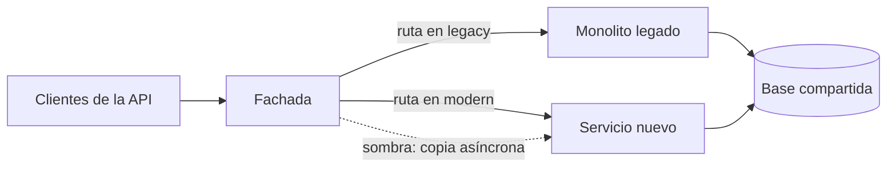

# Strangler fig: reemplazar un sistema sin apagarlo

## La idea

El nombre viene de una higuera que crece alrededor de un árbol hasta reemplazarlo (Martin Fowler, 2004). En software: en lugar de reescribir todo y hacer un "big bang", se pone una **fachada** delante del sistema viejo y se van pasando funcionalidades al nuevo **de a una ruta por vez**. Cada paso es chico, medible y reversible. Cuando ya no queda nada en el viejo, se apaga.

## Por qué no reescribir de cero

- El sistema viejo tiene comportamiento que **nadie documentó** pero del que alguien depende (en este repo: "no encontrado" responde 200, colecciones `null`, un orden de fechas incorrecto).
- Una reescritura completa tarda meses sin entregar valor y llega con todos los riesgos juntos.
- Con la fachada, cada ruta se migra, se mide y, si algo sale mal, se vuelve atrás cambiando un flag, sin deploy.

## La fachada de este repo

- Conoce las rutas por nombre (`customer_get`, `customer_360`, `ticket_list`, `customer_phone_put`). Lo que no reconoce va al legado tal cual.
- Cada ruta tiene un **modo**: `legacy` → `shadow` → `canary` (porcentaje) → `modern`.
- Solo las rutas **sin efectos** (GET) pueden ir en sombra o tener fallback. Duplicar una escritura no es observabilidad: es un bug.
- Agrega la cabecera `X-Served-By` y métricas por ruta y backend.
- Los flags se cambian en caliente por `/admin/flags` (en producción iría detrás de autenticación).

## Riesgos y cómo se mitigan

| Riesgo | Mitigación |
|---|---|
| La fachada suma latencia | Se mide: escenario `fachada-legacy` contra `baseline-legacy` |
| El nuevo responde distinto | Sombra con comparador campo por campo antes de mandarle tráfico real |
| El nuevo falla en canary | Fallback al legado en lecturas y métrica `facade_fallback_total` |
| Base compartida durante la transición | Migración expand/contract: cambios aditivos hasta el final |
| Borrar algo que el legado todavía lee | `Contract` exige que ninguna ruta pueda llegar al legado |
