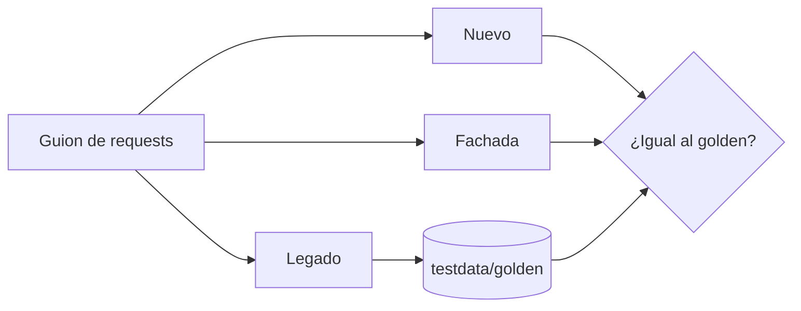

# Tests de caracterización y golden master

## El problema

Para reemplazar código sin tests hay que saber qué hace **hoy**, no qué debería hacer. Michael Feathers (*Working Effectively with Legacy Code*) llama **tests de caracterización** a los que fijan el comportamiento actual, incluidos los errores.

## Golden master

Se graba la salida exacta del sistema viejo para un guion de requests (`testdata/golden/*.json`: 24 casos, con lecturas, escrituras y errores) y se exige que cualquier implementación produzca **exactamente** lo mismo.

En este repo el mismo guion corre contra:

1. el legado (`TestGoldenLegacy`), que regenera el golden con `-update`;
2. el nuevo (`TestGoldenModern`);
3. la fachada en cada modo (`TestGoldenThroughFacade`);
4. el nuevo y el legado durante la migración (`TestGoldenDuringMigration`);
5. el nuevo después de cambiar lecturas y después de contraer (`TestGoldenAfterReadSwitch`, `TestGoldenAfterContract`), donde la **única** diferencia permitida es el teléfono.

## Rarezas con nombre

El golden ya las fija, pero un diff de JSON no explica **por qué** importan. Por eso hay tests con nombre que corren contra el legado y contra el nuevo:

- `TestQuirkNotFoundIs200`: "no encontrado" es 200 con `{"error":"not found"}`.
- `TestQuirkNullCollections`: sin tickets, `"tickets": null`, no `[]`.
- `TestQuirkTicketOrderIsLexicographicDDMM`: el listado se ordena comparando fechas `dd/mm/aaaa` como texto (cronológicamente incorrecto).
- `TestQuirkUnknownPriorityAndLimitCap`: prioridad fuera de catálogo sale como `""` y `limit` se topea en 100.

## ¿Por qué conservar bugs?

Porque hay clientes que dependen de ellos. Cambiar el contrato y el motor a la vez hace imposible saber cuál de los dos rompió algo. Primero se migra **sin cambiar comportamiento**; después, cada rareza se retira con una versión nueva de la API (ver ADR-0003).
