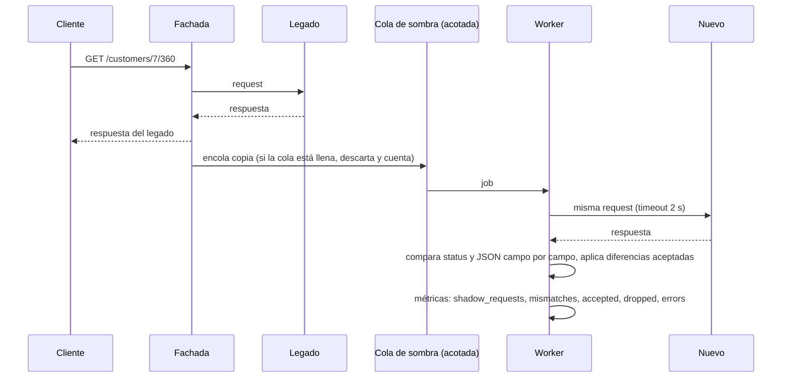
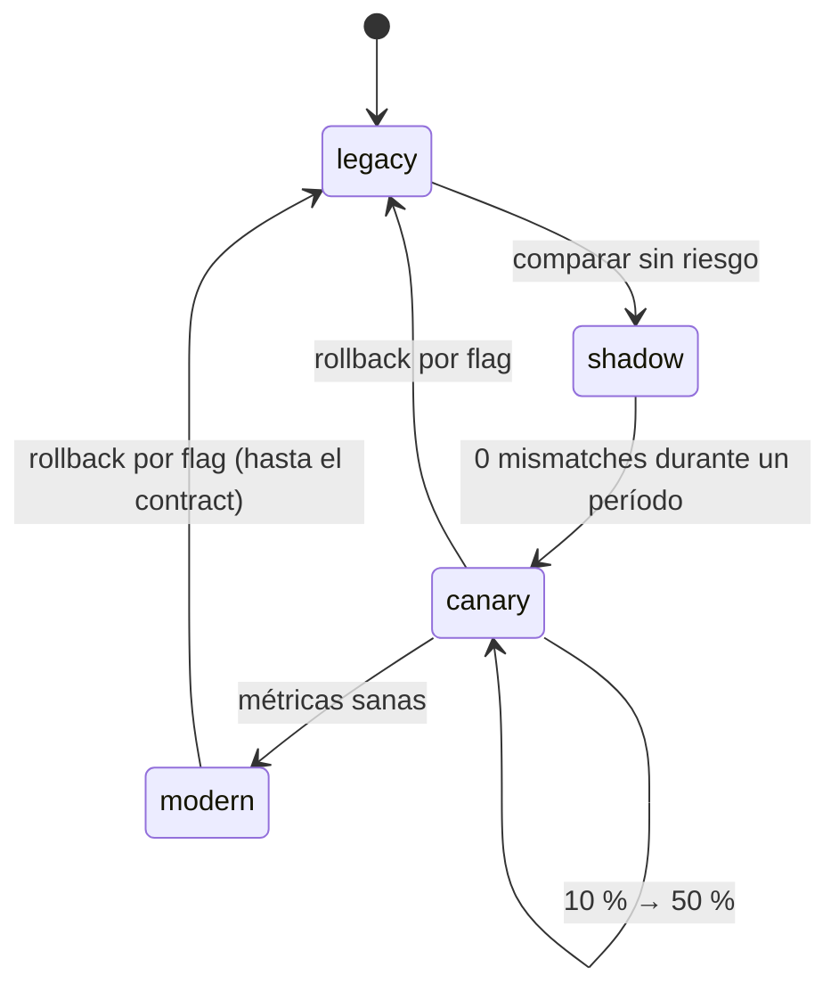

# Tráfico en sombra, comparación y canary

## Sombra (*shadow traffic*, *dark launch*)

El legado sigue respondiendo al cliente. La fachada copia la request y la ejecuta **en segundo plano** contra el nuevo, compara las dos respuestas y registra las diferencias. El cliente no ve nada del nuevo.

### Decisiones

- **Asíncrona y acotada:** 2 workers y una cola de 256. Si se llena, se **descarta** y se cuenta (`shadow_dropped_total`). La sombra nunca puede frenar al usuario. Trade-off: con mucha carga se compara una muestra, no todo.
- **Solo lecturas:** una escritura en sombra duplicaría efectos.
- **Comparación semántica de JSON:** se comparan estructuras, no bytes, y se informa la ruta del campo (`customer.phone`, `tickets[3].agent`). Los índices de arrays se normalizan para las métricas (`tickets[].agent`) y así no explota la cardinalidad.
- **Diferencias aceptadas:** reglas por ruta y por fase. Después de `reads_switched` el teléfono sale normalizado y eso se acepta explícitamente, con el motivo (ADR-0004). Todo lo demás es un mismatch.

### Lo que la sombra no ve

- Escrituras.
- Diferencias de rendimiento bajo carga real (el nuevo corre con otro patrón de concurrencia).
- Una base compartida hace que las dos lecturas vean los mismos datos; si fueran bases distintas, habría diferencias por replicación que hay que filtrar.

## Canary

Un porcentaje de las requests va al nuevo de verdad. La asignación es **estable por clave** (`FNV-1a(ruta + clave) % 100 < porcentaje`):

- **Pegajosa:** el mismo cliente siempre cae del mismo lado. Evita que un usuario vea respuestas que alternan.
- **Monótona:** subir de 10 % a 50 % nunca saca a alguien que ya estaba adentro.
- **Independiente por ruta:** la ruta está en el hash, así el 10 % de una ruta no son siempre los mismos clientes en todas.
- **Fallback:** en canary, si el nuevo da error o 5xx en una lectura, se reintenta en el legado y se cuenta (`facade_fallback_total`).
- **Canary con sombra:** las requests que todavía atiende el legado se comparan también contra el nuevo.

## Avance típico de una ruta

