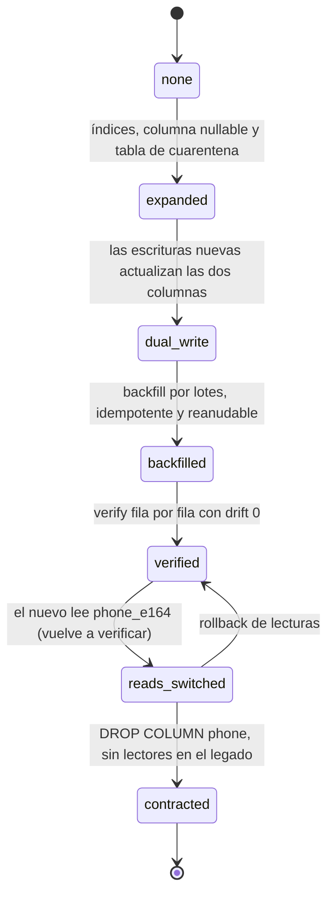

# Migración de esquema expand/contract

## El problema

Hay que pasar el teléfono del cliente de `customers.phone` (texto libre: "011 4321-0000", "(11) 4321 0000", "15-1111-2222") a `customers.phone_e164` (normalizado, por ejemplo `+541143210000`). La base la comparten el legado y el nuevo, y no puede haber downtime. Un `ALTER TABLE ... RENAME` rompería al legado al instante.

## La técnica

También llamada *parallel change*: primero se **expande** (se agrega lo nuevo sin tocar lo viejo), se migra con los dos conviviendo y recién al final se **contrae** (se borra lo viejo).

## Cada fase y por qué en ese orden

1. **Expand:** cambios aditivos. Los índices también benefician al legado (ver `legacy-con-indices` en los resultados).
2. **Dual write antes del backfill:** si se hiciera el backfill primero, lo que se escribe mientras corre quedaría desincronizado. Las escrituras de teléfono tienen que pasar por el nuevo (la ruta `customer_phone_put` en modo `modern`).
3. **Backfill por lotes** ordenado por id con keyset (`WHERE id > ? ORDER BY id LIMIT ?`), una transacción por lote. Es **idempotente** (solo escribe filas cuyo valor difiere) y **reanudable**. Los teléfonos que no se pueden normalizar con confianza van a una **tabla de cuarentena** con el texto original: no se pierden ni se inventan.
4. **Verify:** compara cada fila contra lo que daría normalizar el valor viejo. Cualquier diferencia es *drift* y bloquea el avance. Un escritor que no hace dual write (por ejemplo, el legado llamado directo) genera drift; está probado en `TestVerifyDetectsDriftFromLegacyWriter`, y un nuevo backfill lo repara.
5. **Switch de lecturas:** vuelve a verificar antes de cambiar. Es reversible (`RollbackReads`).
6. **Contract:** el único paso sin vuelta atrás. Exige drift 0 y que **ninguna** ruta de la fachada pueda llegar al legado, porque el legado traga errores: después del `DROP COLUMN` respondería 200 "not found" en silencio (lo prueba el paso 7 de `TestFullStranglerRollout`).

## Estado de la migración

Se persiste en `migration_state` (para procesos separados, como `cmd/migrate`) y se mantiene en memoria con un `atomic.Int32`, para que la ruta de lectura no pague una consulta extra por request.

## En producción

- Backfill con *throttling* (pausas entre lotes) para no saturar la base ni la replicación.
- En MySQL, un `ALTER` de una tabla grande se hace con herramientas *online* (gh-ost, pt-online-schema-change) o con el DDL online del motor.
- La verificación sobre millones de filas se hace por rangos y en réplica, con checksums por bloque.
