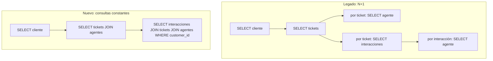

# N+1, índices y cómo medir antes y después

## El problema N+1

Una consulta trae N filas y después se hace **una consulta más por cada fila**. En el legado:

- Vista 360: 1 consulta para el cliente, 1 para sus tickets, y por cada ticket una para el agente y otra para las interacciones, y por cada interacción otra para el agente (N+1 anidado).
- Listado: trae **toda** la tabla de tickets, filtra y ordena en memoria, y por cada ticket del resultado hace 3 consultas más.

El nuevo hace la vista 360 en 3 consultas como máximo (cliente, tickets con su agente por JOIN, interacciones de todos los tickets del cliente con su agente por JOIN) y el listado en **1** consulta.



## Índices

El esquema legado no tiene índices secundarios. Sin índice en `tickets(customer_id)` o `interactions(ticket_id)`, cada búsqueda recorre la tabla entera.

**Resultado no intuitivo, medido:** el código nuevo **sin índices** es más lento que el legado en la vista 360 (escenario `modern-sin-indices`). El plan de SQLite (`EXPLAIN QUERY PLAN`) lo explica:

```text
consulta de interacciones del nuevo, sin índices:
  SCAN i                                           ← recorre las 30 000 interacciones
  SEARCH t USING INTEGER PRIMARY KEY (rowid=?)     ← y por cada una busca su ticket
  USE TEMP B-TREE FOR ORDER BY                     ← y después ordena
consulta por ticket del legado:
  SCAN interactions                                ← un recorrido simple, sin JOIN
```

El nuevo hace una búsqueda en el B-tree de tickets por **cada** interacción de la base para quedarse con las de un cliente, y además ordena. El legado hace un recorrido simple por ticket, y un cliente tiene pocos tickets. Con 4 clientes concurrentes, la diferencia crece. Con el índice `interactions(ticket_id)` y `tickets(customer_id)`, el plan pasa a buscar solo los tickets del cliente y sus interacciones.

Conclusión: **arreglar el N+1 sin agregar índices puede empeorar las cosas**, y los índices solos, sin tocar el código, dan una mejora grande. Por eso el benchmark separa los dos efectos.

## Cómo está diseñado el benchmark

- **Mismo dataset** (generador con semilla fija: 800 clientes, 30 agentes, 6000 tickets y 30 000 interacciones) y **mismas requests** (semilla fija) en todos los escenarios. Cada escenario arranca de una copia de la misma base.
- **Escenarios que aíslan efectos:** línea base, solo índices, solo código, costo de la fachada, sombra y estado final.
- **Consultas por request** contadas en serie (un contador en el driver), para que el número sea exacto y no dependa de la máquina.
- **Latencia** medida en el cliente HTTP, con calentamiento descartado y percentiles *nearest-rank*.
- **3 repeticiones** con rango mín–máx (`scripts/bench-repeticiones.sh`), porque una corrida en una máquina compartida no alcanza.

## Lo que el benchmark no dice

- Es SQLite en proceso y por loopback, no MySQL por red con réplicas. Los números absolutos no se trasladan; las **proporciones** y las **consultas por request** sí orientan.
- Carga de lazo cerrado con 4 clientes: mide latencia de servicio, no el comportamiento ante picos (para eso, ver la prueba de lazo abierto del repo del gateway).
- El orden heredado del listado (`strftime` como texto) no puede usar un índice: el nuevo sigue ordenando la tabla filtrada entera. Corregirlo exige cambiar el contrato (ADR-0003).
